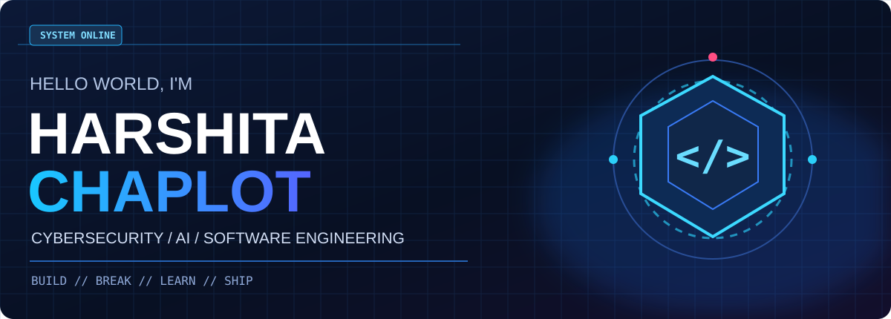
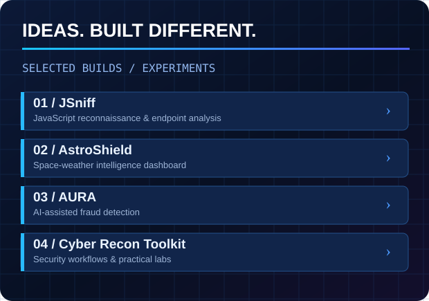
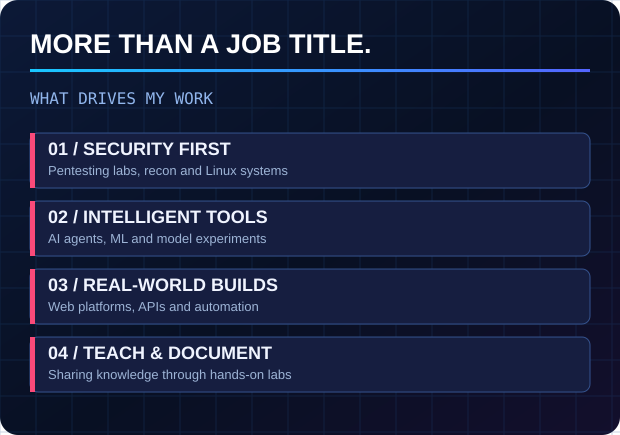
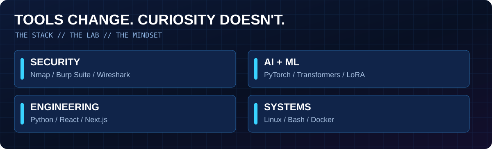

<!-- HARSHITA CHAPLOT | GITHUB PROFILE README -->

<div align="center">



<br/>

<a href="https://github.com/HARSHITACHAPLOT08">

</a>
<a href="https://www.linkedin.com/in/harshita-chaplot-059b42335">

</a>
<a href="https://tryhackme.com/p/harshitachaplot08">

</a>
<a href="https://www.kaggle.com/harshitachaplot">

</a>

<br/><br/>


</div>

---

## `> whoami`

I'm **Harshita Chaplot**, a Computer Science student building at the intersection of **Cybersecurity, Artificial Intelligence, and Software Engineering**.

I enjoy developing security tools, exploring AI systems, working with Linux, and understanding how real-world applications are built and secured.

- 🛡️ **Cybersecurity:** Reconnaissance, VAPT, Web Security, Network Security
- 🤖 **Artificial Intelligence:** AI Agents, LLMs, Fine-Tuning, AI Security
- 🐧 **Linux:** Kali Linux, Automation, Bash, System Internals
- 💻 **Development:** Python, Full-Stack Applications, APIs
- 🎓 **Knowledge Sharing:** Cybersecurity Training, Practical Labs, Technical Documentation

> **My philosophy:** Build it. Understand it. Test it. Improve it.

---

## `> system --overview`

<table>
<tr>
<td width="50%">

</td>
<td width="50%">

</td>
</tr>
</table>

---

## `> featured --projects`

A selection of projects across cybersecurity, AI, automation, and software engineering.

| Project | Description | Technology |
|:---|:---|:---|
| 🛡️ **[JSniff](https://github.com/HARSHITACHAPLOT08/jsniff)** | JavaScript reconnaissance, endpoint extraction and security analysis | Python, Web Security |
| 🌌 **[AstroShield](https://github.com/HARSHITACHAPLOT08/AstroShield_final)** | Space-weather intelligence and monitoring platform | Next.js, TypeScript, APIs |
| 🤖 **[AI Agent](https://github.com/HARSHITACHAPLOT08/AI-Agent)** | Model fine-tuning and AI experiments | Gemma, Tunix, LoRA |
| 🔐 **[AURA](https://github.com/HARSHITACHAPLOT08/AURA)** | AI-assisted fraud detection system | Python, Flask, ML |
| 🔎 **[Cyber Recon Toolkit](https://github.com/HARSHITACHAPLOT08/Cyber-Recon-Toolkit)** | Reconnaissance tools, commands and practical documentation | Kali Linux, OSINT |
| 🌐 **[Web Sentinel](https://github.com/HARSHITACHAPLOT08/web-sentinel)** | Website monitoring and change detection | Python, Streamlit |

<details>
<summary><b>Explore more projects</b></summary>

<br/>

| Project | Description |
|:---|:---|
| [HackEarth AI Agent](https://github.com/HARSHITACHAPLOT08/hackearth-ai-agent) | AI model training and inference experiments |
| [Assignment Vault](https://github.com/HARSHITACHAPLOT08/assignment-vault) | Academic resource management application |
| [Smart Delivery Simulator](https://github.com/HARSHITACHAPLOT08/Smart-Delivery-Simulator) | Route optimization and delivery simulation |
| [Harshi AI TimeWhisper](https://github.com/HARSHITACHAPLOT08/Harshi_AI_TimeWhisper) | Android voice-reminder application |
| [OverTheWire Writeups](https://github.com/HARSHITACHAPLOT08/OverTheWire-Bandit-Writeups) | Linux security challenge documentation |
| [WiFi Evictor](https://github.com/HARSHITACHAPLOT08/WiFi-Evictor) | Wireless security research and lab tooling |

</details>

---

## `> tech-stack --show`



### Languages & Development

<p align="center">

</p>

### Infrastructure & Tools

<p align="center">

</p>

### Cybersecurity

`Kali Linux` `Nmap` `Burp Suite` `Wireshark` `FFUF` `Gobuster` `Nikto` `OSINT` `VAPT` `API Security` `Linux Security`

### Artificial Intelligence

`AI Agents` `LLMs` `Fine-Tuning` `LoRA` `Transformers` `Gemma` `PyTorch` `Machine Learning` `AI Security`

---

## `> cyber-lab --status`

My cybersecurity learning focuses on practical experimentation, authorized security testing and building reusable security automation tools.

```text
CYBERSECURITY LAB
│
├── Reconnaissance
│   ├── OSINT & Footprinting
│   ├── Subdomain Enumeration
│   └── Web Reconnaissance
│
├── Network Security
│   ├── Nmap & Service Discovery
│   ├── Wireshark Traffic Analysis
│   └── Network Protocols
│
├── Web & API Security
│   ├── Burp Suite
│   ├── Authentication & Sessions
│   └── Vulnerability Assessment
│
├── Linux Security
│   ├── Privilege Escalation Labs
│   ├── Bash Automation
│   └── System Administration
│
└── AI Security
    ├── LLM Exploration
    ├── AI-Assisted Analysis
    └── Security Automation
```

---

## `> currently --exploring`

| Area | Current Direction |
|:---|:---|
| 🛡️ Cybersecurity | VAPT, Security Automation, API Security |
| 🤖 AI Security | AI Agents, LLMs, Red Teaming Research |
| 🐧 Linux | System Internals, Automation, OS Customization |
| 📱 Android Security | APK Analysis, Reverse Engineering |
| 💻 Engineering | Full-Stack Applications, Backend Systems |

---

## `> achievements --highlights`

- 🏆 **Techno Tarang Hackathon 3.0:** Top 10 out of 180 teams; highest points in the software category
- 🎓 **Academic Excellence:** 9.8 CGPA and Kal Bai Award
- 🐧 **Red Hat Certified System Administrator (RHCSA)**
- 🛡️ **Cybersecurity Specialist:** Hackinetix Academy
- 🤖 **AI Learning:** Google/Kaggle AI Agents programs
- 👩‍🏫 **Technical Knowledge Sharing:** Cybersecurity training and hands-on labs

---

## `> github --analytics`

<div align="center">


<br/><br/>


</div>

---

## `> connect --with-me`

<div align="center">

<a href="https://www.linkedin.com/in/harshita-chaplot-059b42335">

</a>

<a href="https://tryhackme.com/p/harshitachaplot08">

</a>

<a href="https://github.com/HARSHITACHAPLOT08?tab=repositories">

</a>

<br/><br/>

### ⚡ BUILD → BREAK → LEARN → SHIP → REPEAT

*Exploring the intersection of AI, Cybersecurity & Engineering.*

</div>
